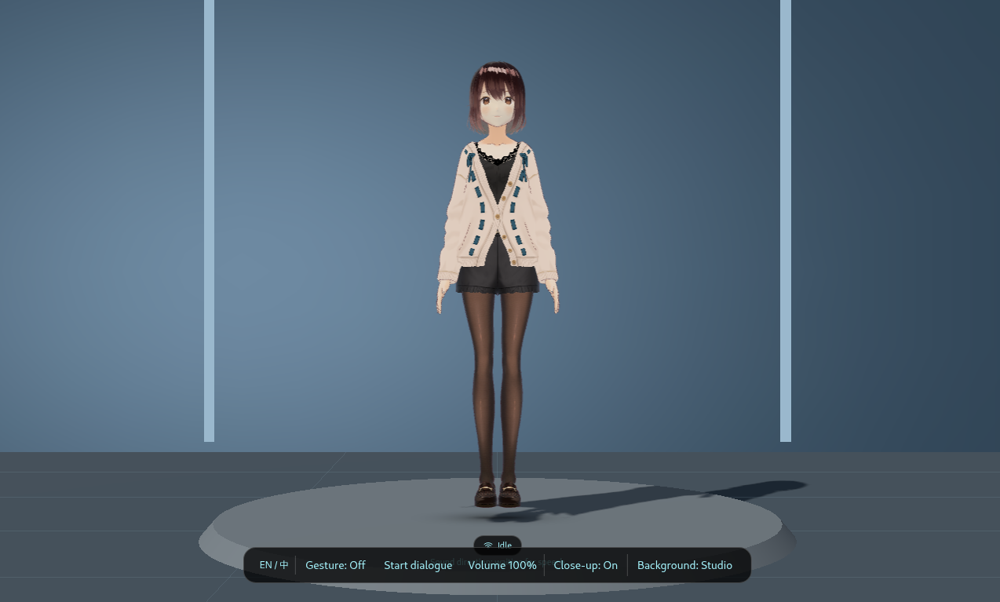

# Desktop Companion Assistant

[中文](README_zh.md) | English

Desktop Companion Assistant is a desktop companion for the Quectel PI M2 Smart Single-Board Computer (RK3576, Debian ARM64). It combines a transparent Electron interface, a VRM character, voice conversation, on-demand hand-gesture recognition, and microphone-array direction tracking.



## Features

- **Desktop companion**: A draggable VRM character with switchable transparent-overlay and 3D studio backgrounds.
- **Voice conversation**: Bailian speech recognition, AI replies, and speech synthesis, with continuous dialogue and click-to-interrupt controls. The character displays speech-driven mouth movements and expressions.
- **Gesture interaction**: The RK3576 NPU is used by default to detect hand landmarks, with a hand-skeleton overlay in the preview. Vertical swipes adjust only the assistant's speech volume. The camera and models start on demand and are released when the preview is closed.
- **Sound-direction tracking**: A microphone array estimates the sound direction and turns the character's head toward it. Direction tracking can be disabled as needed.


## Hardware Requirements

- Quectel PI M2 Smart Single-Board Computer running Debian ARM64.
- A logged-in desktop with an accessible X11 display for the Electron interface. Backend-only mode does not require a graphical desktop.
- USB camera for gesture preview.
- Audio input and output for voice conversation. A microphone array is required only for sound-direction tracking; a USB or camera microphone can be used for speech when tracking is disabled. Check devices with `arecord -l`.

## Software Environment

| Component | Requirement |
| --- | --- |
| Python | 3.11 (installed with `uv`) |
| Node.js and npm | Node.js 22.16.0 ARM64 build (the launcher's default path) |
| Python packages | Installed from the root `requirements.txt` |
| Frontend packages | Installed from `aura_app/frontend/package-lock.json` |
| Linux audio / desktop tools | `alsa-utils`, `espeak-ng`, `libespeak1`; `x11-utils` for Electron mode |

Use Python 3.11 and an ARM64 Node.js build supported by the board. The RKNN Python package in `requirements.txt` and the bundled models target RK3576.

## Installation

Run the following commands on the board. The commands below use the public GitHub URL; if the repository is private, configure an SSH key on the board and use the SSH clone URL instead.

1. Install system utilities and clone the repository:

   ```bash
   sudo apt update
   sudo apt install -y ca-certificates curl git alsa-utils espeak-ng libespeak1 x11-utils
   cd "$HOME"
   git clone https://github.com/jjking619/demo-desktop-companion-assistant.git
   cd demo-desktop-companion-assistant
   ```

2. Install Python 3.11. Debian 13's default Python is newer; use `uv` to install the required Python version without changing the system Python:

   ```bash
   curl -LsSf https://astral.sh/uv/install.sh | sh
   export PATH="$HOME/.local/bin:$PATH"
   uv python install 3.11
   uv python find 3.11
   ```

   If `uv` is already installed, skip its installer and ensure `~/.local/bin` is on `PATH`.

3. Install the tested Node.js 22.16.0 ARM64 build from the official Node.js distribution and verify its SHA-256 checksum:

   ```bash
   cd /tmp
   curl -fLO https://nodejs.org/dist/v22.16.0/node-v22.16.0-linux-arm64.tar.xz
   printf '%s  %s\n' \
     'eab80cb88f8fda1e65f5e8d0420c9809bdb320b03fd34976ab7161b6e703b910' \
     'node-v22.16.0-linux-arm64.tar.xz' | sha256sum -c -
   mkdir -p "$HOME/.local/opt"
   tar -xJf node-v22.16.0-linux-arm64.tar.xz -C "$HOME/.local/opt"
   rm node-v22.16.0-linux-arm64.tar.xz
   export PATH="$HOME/.local/opt/node-v22.16.0-linux-arm64/bin:$PATH"
   node --version
   npm --version
   ```

   `node --version` should print `v22.16.0`. These `PATH` exports apply to the current terminal; add them to `~/.profile` if you want them in new login sessions. The launcher adds this exact Node directory automatically when it exists. If you use another Node installation path, make sure it is on `PATH` before launching.

4. Create the backend virtual environment and install its dependencies:

   ```bash
   cd ~/demo-desktop-companion-assistant
   uv venv --python 3.11 aura_app/backend/.venv
   uv pip install --python aura_app/backend/.venv/bin/python -r requirements.txt
   ```

5. Install the frontend dependencies:

   ```bash
   cd aura_app/frontend
   npm ci
   cd ../..
   ```

   The launcher builds the frontend when starting the Electron interface.

6. Configure voice services if using Bailian. The example file selects Bailian; add a valid API key and set `AURA_MIC_DEVICE` to an input device shown by `arecord -l`:

   ```bash
   cp aura_app/backend/bailian.env.example .env
   chmod 600 .env
   ```

   Edit `.env` locally and set `DASHSCOPE_API_KEY` and the desired `AURA_MIC_DEVICE`.

   If a microphone array is connected, sound-direction tracking is enabled by default and speech recognition uses that array (`AURA_SOUND_DEVICE`, default `hw:MicArray,0`). Without an array, disable tracking when launching; speech recognition will then use the `.env` `AURA_MIC_DEVICE` instead.

7. Download [AvatarSample_A.vrm from madjin/vrm-samples](https://github.com/madjin/vrm-samples/blob/master/vroid/stable/AvatarSample_A.vrm), keeping its original filename:

   ```bash
   mkdir -p aura_app/frontend/public/characters
   curl --fail --location \
     https://raw.githubusercontent.com/madjin/vrm-samples/master/vroid/stable/AvatarSample_A.vrm \
     --output aura_app/frontend/public/characters/AvatarSample_A.vrm
   printf '%s  %s\n' \
     'b86b0b8a66d48911431d6f920a5211a974226f83aa672eca3f3dfade58ac346e' \
     'aura_app/frontend/public/characters/AvatarSample_A.vrm' | sha256sum -c -
   ```

   The checksum should report `OK`; do not start the application if downloading or verification fails. The model is not distributed with this repository and is not CC0. Read the [official VRoid AvatarSample_A/B/C conditions of use](https://vroid.pixiv.help/hc/en-us/articles/4402394424089) before using, modifying, or redistributing it.


## Project Structure

```text
demo-desktop-companion-assistant/
├── aura_app/
│   ├── backend/                 # FastAPI, voice, audio, and gesture processing
│   │   └── models/rknn/         # RK3576 hand models and license files
│   └── frontend/                # Electron, React, and VRM interface
├── StartAURA_Linux.sh           # Linux launcher
├── requirements.txt             # Python dependencies
├── README.md                    # English documentation (GitHub default)
├── README_zh.md                 # Chinese documentation
```

`.env` and `AvatarSample_A.vrm` are local files and are intentionally excluded from Git.

## Run the Program

Run the Electron interface from a logged-in desktop terminal:

```bash
cd ~/demo-desktop-companion-assistant
./StartAURA_Linux.sh
```

The launcher builds the frontend, starts the backend, and opens the transparent companion window. Press `Ctrl+C` in that terminal to stop it.

With the default settings, the app expects a microphone array for sound-direction tracking. If no array is connected, disable tracking for this launch:

```bash
AURA_SOUND_LOCALIZATION=0 ./StartAURA_Linux.sh
```

In that mode, speech recognition uses `AURA_MIC_DEVICE` from `.env`. With tracking enabled, it uses the array device instead; changing `AURA_MIC_DEVICE` alone will not fix a missing-array error.

Start Electron from a terminal inside the logged-in desktop session. An SSH shell usually does not inherit the desktop's X11/Xwayland authorization; use `--backend-only` for headless SSH access rather than copying another session's display credentials.

To run only the backend, without X11 or Electron:

```bash
AURA_SOUND_LOCALIZATION=0 ./StartAURA_Linux.sh --backend-only
```

This disables microphone-array tracking for this run; omit the prefix if an array is connected and configured. In another terminal, check the API:

```bash
curl --fail http://127.0.0.1:8000/
```

## Common Settings

Set an option before launching the assistant. Restart the application after changing settings.

| Variable | Linux launcher default | Purpose |
| --- | --- | --- |
| `AURA_GESTURE_BACKEND` | `rknn` | Gesture backend: `rknn` (RK3576 NPU), `legacy` (MediaPipe CPU), or `remote`. |
| `AURA_GESTURE_VOLUME` | `1` | Enable vertical swipes to adjust the assistant's speech volume. Set to `0` to disable. Recognition still starts only when gesture preview is opened. |
| `AURA_CAMERA` | First `/dev/v4l/by-id/*-video-index0` device | Select the camera device. |
| `AURA_SOUND_LOCALIZATION` | `1` | Enable microphone-array direction tracking. Set to `0` to disable. |
| `AURA_SOUND_DEVICE` | `hw:MicArray,0` | Microphone-array input used for direction tracking and speech capture while tracking is enabled. |
| `AURA_MIC_DEVICE` | From `.env` | Regular microphone input used for speech capture when sound-direction tracking is disabled. |
| `AURA_SOFTWARE_RENDERING` | `0` | Use Mali GPU rendering. Set to `1` to explicitly use software rendering. |
| `AURA_ALSA_DEVICE` | Board speaker device | Select an ALSA output device. Set to an empty value to use the PipeWire/PulseAudio path when available. |

For example, to disable swipe volume:

```bash
AURA_GESTURE_VOLUME=0 ./StartAURA_Linux.sh
```

Vertical swipes change only the assistant's own speech playback gain, not the system mixer or other applications. Use the Dock's gesture-preview control to start and stop camera capture.

## Character Model

The active model is loaded from `aura_app/frontend/public/characters/AvatarSample_A.vrm`. To use another authorized humanoid VRM, place it under `aura_app/frontend/public/characters/`, update `vrmCharacter.model` in `aura_app/frontend/src/components/vrmCharacter.ts`, and rebuild the frontend. The model should provide `aa`, `ih`, `ou`, `ee`, and `oh` mouth expressions. Check all model and animation licenses before redistribution.

## Troubleshooting and Issues

- **Missing Python environment or `python3.11`:** use `uv python install 3.11`, then create the virtual environment and install `requirements.txt` as shown above. Debian 13's system Python version is not used.
- **`uv` not found:** add `~/.local/bin` to `PATH` or run the official uv installer shown above.
- **`node` or `npm` not found:** add `$HOME/.local/opt/node-v22.16.0-linux-arm64/bin` to `PATH`, or repeat the Node.js installation step. Electron mode also requires `x11-utils` and a logged-in desktop session; use `--backend-only` on a headless terminal.
- **uv installer reports a connection reset:** retry the install command after checking the network; a transient download failure does not require changing the Python version.
- **Clone over SSH fails:** configure the board's GitHub SSH key, or use the HTTPS clone URL if the repository is public.
- **MicArray / sound-localization error at startup:** the launcher enables array tracking by default. Connect the array and check `arecord -l` / `AURA_SOUND_DEVICE`, or set `AURA_SOUND_LOCALIZATION=0` if no array is connected.
- **Speech input still tries to open MicArray:** while sound localization is enabled, ASR uses `AURA_SOUND_DEVICE`; `AURA_MIC_DEVICE` applies only when localization is disabled. Restart using `AURA_SOUND_LOCALIZATION=0 ./StartAURA_Linux.sh` to use the regular microphone.
- **RKNN preview fails to load:** confirm the RKNN files and `manifest.json` exist in `aura_app/backend/models/rknn/`, then check the backend error message. The models require the RK3576 runtime.
- **Warnings:** `npm ci` may print deprecation or `npm audit` notices even when installation succeeds; review reported vulnerabilities separately and do not run `npm audit fix` blindly on the locked dependencies. The static-shape RKNN dynamic-range query and Electron VSync warnings were also observed during successful runs; investigate if the corresponding feature actually fails.
- **No character appears:** confirm the local VRM file is at the path above and is named exactly `AvatarSample_A.vrm`.

For issues, include the board model, operating system, startup command, and relevant error output. Remove API keys and other secrets before sharing logs.

## Third-Party Licenses

Third-party models and character assets have their own licensing terms. Retain the accompanying model license and attribution files, and check the upstream terms before redistribution.

## Reporting Issues

For project bugs or feature requests, [open an issue](https://github.com/jjking619/demo-desktop-companion-assistant/issues). Include your board model, operating system, reproduction steps, startup command, and relevant error logs or screenshots. Remove API keys and other sensitive information before posting. For Quectel Pi board or platform support, visit the [Quectel Pi Forum](https://forums.quectel.com/c/quectel-pi/80). Pull requests for improvements are welcome.
