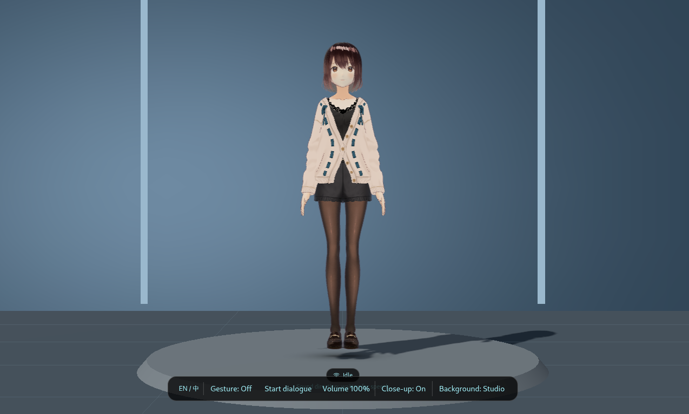

# 桌面陪伴助手

[English](README.md) | 中文

桌面陪伴助手基于 Quectel PI M2 智能主控板（RK3576、Debian ARM64）开发，集成 Electron 悬浮界面、VRM 人物、语音对话、按需手势识别和麦克风阵列声源定位。




## 功能特性

- **桌面人物陪伴**：可拖动的 VRM 人物，支持透明悬浮与 3D 摄影棚背景切换。
- **语音对话**：支持百炼语音识别、智能回复和语音合成；可开启连续对话、点击打断回复，人物随语音呈现口型与表情。
- **手势交互**：默认使用 RK3576 NPU 识别手部关键点，预览中显示手部骨架；上下滑动可调节助手自身的语音音量。摄像头和模型按需启动，关闭预览后释放资源。
- **声源跟随**：通过麦克风阵列估计声源方向，驱动人物头部转向；可按需关闭声源定位。

## 硬件要求

- Quectel PI M2 智能主控板，Debian ARM64。
- 已登录且可访问的 X11 桌面；仅运行后端不需要图形桌面。
- 手势预览需要 USB 摄像头。
- 语音对话需要麦克风输入和音频输出；声源跟随功能才需要麦克风阵列。关闭声源定位后，可使用 USB 摄像头麦克风录音。使用 `arecord -l` 查看录音设备。

## 软件环境

| 组件 | 要求 |
| --- | --- |
| Python | 3.11（使用 `uv` 安装） |
| Node.js 和 npm | Node.js 22.16.0 ARM64 版本（启动脚本默认查找路径） |
| Python 依赖 | 使用仓库根目录的 `requirements.txt` 安装 |
| 前端依赖 | 使用 `aura_app/frontend/package-lock.json` 安装 |
| Linux 音频/桌面工具 | `alsa-utils`、`espeak-ng`、`libespeak1`；Electron 模式还需要 `x11-utils` |

请使用板端支持的 Python 3.11 和 ARM64 Node.js。`requirements.txt` 中的 RKNN Python 包及仓库内的模型面向 RK3576。

## 部署步骤

以下命令在板端执行。默认使用 GitHub HTTPS 地址；如果仓库是私有的，请先在开发板配置 SSH Key，再使用 SSH 克隆地址。

1. 安装系统工具并克隆项目：

   ```bash
   sudo apt update
   sudo apt install -y ca-certificates curl git alsa-utils espeak-ng libespeak1 x11-utils
   cd "$HOME"
   git clone https://github.com/jjking619/demo-desktop-companion-assistant.git
   cd demo-desktop-companion-assistant
   ```

2. 安装 Python 3.11。Debian 13 默认 Python 版本较新，使用 `uv` 安装项目所需版本，不替换系统 Python：

   ```bash
   curl -LsSf https://astral.sh/uv/install.sh | sh
   export PATH="$HOME/.local/bin:$PATH"
   uv python install 3.11
   uv python find 3.11
   ```

   如果已经安装 `uv`，可跳过安装命令，但需确保 `~/.local/bin` 已加入 `PATH`。

3. 安装已验证的官方 Node.js 22.16.0 ARM64 版本，并校验 SHA-256：

   ```bash
   cd /tmp
   curl -fLO https://nodejs.org/dist/v22.16.0/node-v22.16.0-linux-arm64.tar.xz
   printf '%s  %s\n' \
     'eab80cb88f8fda1e65f5e8d0420c9809bdb320b03fd34976ab7161b6e703b910' \
     'node-v22.16.0-linux-arm64.tar.xz' | sha256sum -c -
   mkdir -p "$HOME/.local/opt"
   tar -xJf node-v22.16.0-linux-arm64.tar.xz -C "$HOME/.local/opt"
   rm node-v22.16.0-linux-arm64.tar.xz
   export PATH="$HOME/.local/opt/node-v22.16.0-linux-arm64/bin:$PATH"
   node --version
   npm --version
   ```

   `node --version` 应输出 `v22.16.0`。这里设置的 `PATH` 仅对当前终端有效；如需新登录终端也生效，可将对应两条 `export PATH=...` 命令加入 `~/.profile`。启动脚本会自动加入这个固定 Node 路径；如果安装到其他路径，启动前请确保该路径已在 `PATH` 中。

4. 创建后端虚拟环境并安装依赖：

   ```bash
   cd ~/demo-desktop-companion-assistant
   uv venv --python 3.11 aura_app/backend/.venv
   uv pip install --python aura_app/backend/.venv/bin/python -r requirements.txt
   ```

5. 安装前端依赖：

   ```bash
   cd aura_app/frontend
   npm ci
   cd ../..
   ```

   启动脚本会在启动 Electron 界面时构建前端。

6. 如需使用百炼语音服务，复制配置示例。该示例使用百炼，请填入有效 API Key，并将 `AURA_MIC_DEVICE` 设置为 `arecord -l` 中实际存在的录音设备：

   ```bash
   cp aura_app/backend/bailian.env.example .env
   chmod 600 .env
   ```

   使用本地编辑器修改 `.env`，设置 `DASHSCOPE_API_KEY` 和 `AURA_MIC_DEVICE`。

   如果连接了麦克风阵列，启动脚本默认开启声源定位，语音识别也会使用阵列设备（`AURA_SOUND_DEVICE`，默认 `hw:MicArray,0`）。没有阵列时，启动时关闭声源定位，语音识别才会改用 `.env` 中的 `AURA_MIC_DEVICE`。

7. 下载 [madjin/vrm-samples 的 AvatarSample_A.vrm](https://github.com/madjin/vrm-samples/blob/master/vroid/stable/AvatarSample_A.vrm)，保留原始文件名，无需改名：

   ```bash
   mkdir -p aura_app/frontend/public/characters
   curl --fail --location \
     https://raw.githubusercontent.com/madjin/vrm-samples/master/vroid/stable/AvatarSample_A.vrm \
     --output aura_app/frontend/public/characters/AvatarSample_A.vrm
   printf '%s  %s\n' \
     'b86b0b8a66d48911431d6f920a5211a974226f83aa672eca3f3dfade58ac346e' \
     'aura_app/frontend/public/characters/AvatarSample_A.vrm' | sha256sum -c -
   ```

   校验应输出 `OK`；下载或校验失败时不要继续启动。模型不随本仓库分发，也不是 CC0；使用、修改或重新分发前请阅读 [VRoid 官方 AvatarSample_A/B/C 使用条件](https://vroid.pixiv.help/hc/en-us/articles/4402394424089)。


## 项目结构

```text
demo-desktop-companion-assistant/
├── aura_app/
│   ├── backend/                 # FastAPI、语音、音频和手势处理
│   │   └── models/rknn/         # RK3576 手势模型及许可证
│   └── frontend/                # Electron、React 和 VRM 界面
├── StartAURA_Linux.sh           # Linux 启动脚本
├── requirements.txt             # Python 依赖
├── README.md                    # 英文说明（GitHub 默认展示）
├── README_zh.md                 # 中文说明
```

## 运行程序

在已登录的 GNOME 桌面终端中启动 Electron 界面：

```bash
cd ~/demo-desktop-companion-assistant
./StartAURA_Linux.sh
```

启动脚本会构建前端、启动后端并打开透明陪伴窗口。在启动终端按 `Ctrl+C` 停止。

默认配置会开启麦克风阵列声源定位；如果没有连接阵列，请在启动时关闭：

```bash
AURA_SOUND_LOCALIZATION=0 ./StartAURA_Linux.sh
```

此时语音识别会使用 `.env` 中的 `AURA_MIC_DEVICE`。声源定位开启时则使用阵列设备；仅修改 `AURA_MIC_DEVICE` 无法解决缺少阵列导致的错误。

Electron 需要从已登录的桌面会话终端启动。SSH 终端通常没有桌面 X11/Xwayland 授权；无桌面远程运行请使用 `--backend-only`，不要照搬其他会话的显示授权变量。

如只需运行后端（无需 X11 或 Electron）：

```bash
AURA_SOUND_LOCALIZATION=0 ./StartAURA_Linux.sh --backend-only
```

上面命令会在本次启动中关闭阵列声源定位；已连接并配置阵列时可去掉前缀。在另一个终端中验证 API：

```bash
curl --fail http://127.0.0.1:8000/
```

## 常用配置

启动前设置环境变量；修改配置后需重启桌面陪伴助手。

| 变量 | Linux 启动脚本默认值 | 作用 |
| --- | --- | --- |
| `AURA_GESTURE_BACKEND` | `rknn` | 手势后端：`rknn`（RK3576 NPU）、`legacy`（MediaPipe CPU）或 `remote`。 |
| `AURA_GESTURE_VOLUME` | `1` | 允许上下滑动调整桌面陪伴助手的语音音量；设为 `0` 关闭。仅打开手势预览后才会启动识别。 |
| `AURA_CAMERA` | 第一个 `/dev/v4l/by-id/*-video-index0` 设备 | 指定摄像头设备。 |
| `AURA_SOUND_LOCALIZATION` | `1` | 开启麦克风阵列声源定位；设为 `0` 关闭。 |
| `AURA_SOUND_DEVICE` | `hw:MicArray,0` | 声源定位开启时用于定位和语音采集的阵列输入设备。 |
| `AURA_MIC_DEVICE` | `.env` 中设置 | 关闭声源定位后，用作语音采集的普通麦克风设备。 |
| `AURA_SOFTWARE_RENDERING` | `0` | 默认使用 Mali GPU；显式设为 `1` 使用软件渲染。 |
| `AURA_ALSA_DEVICE` | 板载扬声器设备 | 指定 ALSA 输出设备。设为空值时，在可用情况下使用 PipeWire/PulseAudio。 |

例如，关闭滑动调节语音音量：

```bash
AURA_GESTURE_VOLUME=0 ./StartAURA_Linux.sh
```

上下滑动只调整桌面陪伴助手自身的语音播放增益，不改变系统混音器或其他应用音量。通过 Dock 的手势预览按钮启停摄像头采集。

## 人物模型

当前模型路径为 `aura_app/frontend/public/characters/AvatarSample_A.vrm`。替换模型时，请将有授权的 humanoid VRM 放入 `aura_app/frontend/public/characters/`，修改 `aura_app/frontend/src/components/vrmCharacter.ts` 中的 `vrmCharacter.model`，然后重新构建前端。模型应包含 `aa`、`ih`、`ou`、`ee`、`oh` 五种口型表达。重新分发前请核实模型和动画授权。

## 常见问题与反馈

- **提示缺少 Python 环境或找不到 `python3.11`：** 使用 `uv python install 3.11`，再按上文创建虚拟环境并安装 `requirements.txt`。不使用 Debian 13 的系统 Python 版本。
- **找不到 `uv`：** 将 `~/.local/bin` 加入 `PATH`，或重新运行上文的官方安装命令。
- **找不到 `node` 或 `npm`：** 将 `$HOME/.local/opt/node-v22.16.0-linux-arm64/bin` 加入 `PATH`，或重新执行 Node.js 安装步骤。Electron 模式还需要 `x11-utils` 和已登录的桌面会话；无桌面时使用 `--backend-only`。
- **安装 uv 时连接被重置：** 检查网络后重试安装命令；临时下载失败不代表需要更换 Python 版本。
- **SSH 克隆失败：** 在开发板配置 GitHub SSH Key；若仓库公开，也可改用 HTTPS 克隆地址。
- **启动时报 MicArray / 声源定位错误：** 启动脚本默认开启阵列定位。请连接阵列并用 `arecord -l` 检查设备，必要时设置 `AURA_SOUND_DEVICE`；没有阵列时使用 `AURA_SOUND_LOCALIZATION=0 ./StartAURA_Linux.sh`。
- **语音识别仍尝试打开 MicArray：** 声源定位开启时，ASR 使用 `AURA_SOUND_DEVICE`；`AURA_MIC_DEVICE` 只在关闭定位时生效。请用 `AURA_SOUND_LOCALIZATION=0 ./StartAURA_Linux.sh` 重启以使用普通麦克风。
- **RKNN 预览加载失败：** 确认 `aura_app/backend/models/rknn/` 中存在模型及 `manifest.json`，并检查后端错误信息。模型需要 RK3576 运行时。
- **警告说明：** `npm ci` 即使成功，也可能显示依赖弃用或 `npm audit` 提示；安全审计发现应单独查看，不要对锁定依赖盲目运行 `npm audit fix`。静态 shape RKNN 模型的 dynamic-range 查询警告和 Electron VSync 警告也曾在功能正常时出现；如果对应功能确实异常，再进一步排查。
- **人物未显示：** 确认本地 VRM 文件位于上文路径，且文件名准确为 `AvatarSample_A.vrm`。

反馈问题时请附上板卡型号、操作系统、启动命令和相关错误信息。分享日志前请移除 API Key 等敏感信息。

## 第三方素材许可

第三方模型和人物素材各自适用不同许可。重新分发前请保留随附的模型许可证和署名，并核对上游使用条件。

## 问题反馈

如遇到项目功能问题或有改进建议，请到 [GitHub Issues](https://github.com/jjking619/demo-desktop-companion-assistant/issues) 提交 Issue。请尽量附上板卡型号、操作系统、复现步骤、启动命令及相关错误日志或截图；发布前请移除 API Key 等敏感信息。Quectel Pi 板卡或平台相关问题，也可以前往 [Quectel Pi 官方论坛](https://forums.quectel.com/c/quectel-pi/80)咨询。欢迎通过 Pull Request 贡献改进。
